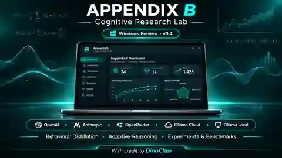

# Appendix B Substrate



*Promotional concept artwork; illustrative dashboard, not measured benchmark results.*

With credit to [DinoClaw](https://github.com/AaronGrace978/DinoClaw).

A dependency-free Python substrate for agent task loops that enforces:

**decompose → skeptical attack → independent verification → conclusion**

It carries continuous numerical emotional-state variables across turns and completed runs. These variables are explicit workflow state—not a claim of human feelings or access to a model's private reasoning.

## What it enforces

- Decomposition before an answer is attempted.
- Multiple skeptical attacks before verification.
- Independently computed checks rather than self-declared success.
- Failed verification returns the agent to the attack phase.
- Unverified conclusions are blocked.
- Emotional state persists across runs instead of resetting each turn.

## Run the demonstration

Requires Python 3.10 or newer. No third-party packages are needed.

```bash
python3 substrate.py
```

The demonstration tests a primality conjecture, finds a counterexample, prints independent checks and the emotional-state trajectory, and confirms that skipping directly to a conclusion is blocked.

## Scope

This substrate governs an agent's external workflow. It cannot guarantee that a language model's private reasoning follows the protocol, and it cannot prove arbitrary claims without appropriate independent verifiers.


## Experimental v0.2 runtime

The original `substrate.py` remains unchanged for baseline comparisons.
The new `runtime_v2.py` implements decomposition, explicit hypotheses,
state-dependent skeptical attacks, claim-bound evidence, and deterministic
conclusions with supported, refuted, or inconclusive verdicts.

```bash
python -m unittest -v test_runtime_v2
python substrate.py
```

Use `Runtime("state.db")` for durable SQLite state and run event history.
The caller supplies an agent callback, a trusted verifier callback, and
the required check identifiers. The verifier must establish actual evidence
and reject claims outside its domain; hashing a claim does not establish truth.
The runtime prevents agent-authored final prose from bypassing verdicts.
Distinct attack strings do not guarantee semantically independent attacks.
Conflicting evidence and callback errors produce inconclusive results.
The state-dependent attack budget is heuristic, not scientifically calibrated.
Attempt limits do not impose wall-clock timeouts on callbacks.
The runtime is synchronous, single-worker, and not a sandbox for untrusted Python.
SQLite records are not tamper-proof; interrupted runs can be inspected but
are not automatically resumed. Use a separate database per worker.


## Experimental v0.3: behavioral distillation

The motivating idea is to observe AI mathematical problem-solving behavior
and translate observable actions into explicit Python control mechanisms.
This is behavioral modeling, not extraction of private model reasoning,
weights, consciousness, or reproduction of a particular unreleased model.

`behavioral.py` adds coupled continuous dynamics, surprise after refutation,
stagnation after repeated candidates, strategy rotation, a bounded candidate
budget, and durable state/decision histories. Refuting a candidate does not
refute the overall search problem. Unresolved searches abstain. Strategies
are instructions for the proposer, not guarantees of independent reasoning.
The verifier remains a trusted external boundary.

```bash
python -m unittest discover -v
python benchmark_behavioral.py
python trace_replay.py observations.jsonl
```

The benchmark is deliberately synthetic and strategy-sensitive. It tests
controller wiring with the same proposer, verifier and maximum candidate
budget in adaptive and fixed conditions, not improvement on actual LLMs.
Neither elapsed time nor model token usage is matched.

### Observation protocol

Create a JSON Lines dataset with one source-tagged observation per line.
Use public source URLs, stable transcript identifiers or experiment IDs,
and a locator such as a turn number. Record externally observable outcomes,
not inferred private thoughts. Example (synthetic):

```json
{"source":"synthetic-fixture","locator":"turn 1","event":"refuted","note":"Arithmetic rejected a candidate divisor."}
{"source":"synthetic-fixture","locator":"turn 2","event":"duplicate","note":"The same candidate was proposed again."}
```

Supported events: supported, refuted, inconclusive and duplicate.
Replay yields deterministic before/after state trajectories. Parameters are
hypotheses, not fitted measurements. No Claude transcript has been ingested
or annotated in this release.

Next: collect documented traces, define an annotation rubric, use held-out
tasks, and compare adaptive, fixed, and rotation-only controllers with real
model callbacks, matched token/tool budgets and independent scoring.
Measure accuracy, abstention, counterexample recovery, cost and robustness.


## Appendix B Desktop Lab — Windows preview

See [desktop setup and Windows release instructions](desktop/README.md).
The experimental desktop lab supports OpenAI, Anthropic, OpenRouter, Ollama
Cloud and Ollama Local. The Windows release pipeline packages a portable
x64 Electron application with Python, and publishes a prerelease only after
automated tests and a packaged launch check succeed.

## Credits

With credit to [DinoClaw](https://github.com/AaronGrace978/DinoClaw).
