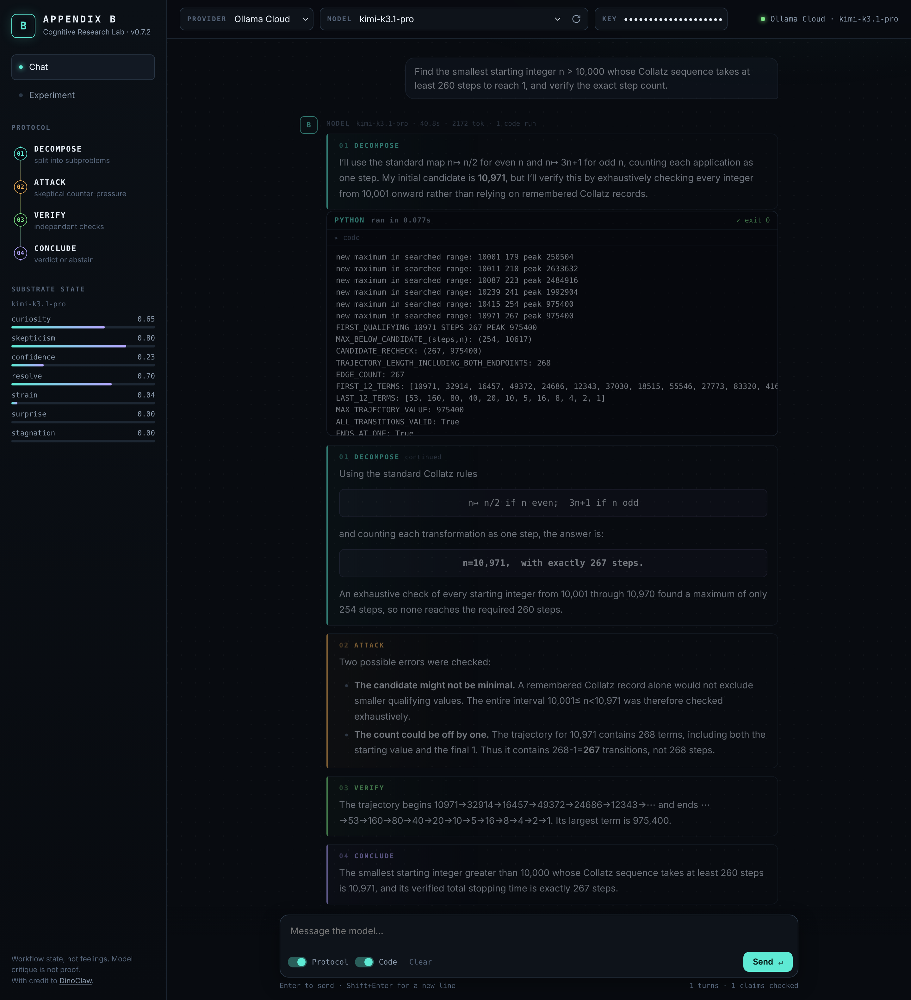
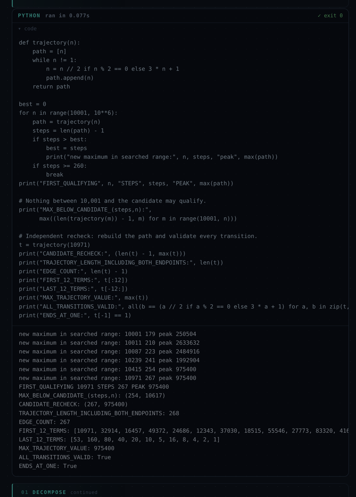
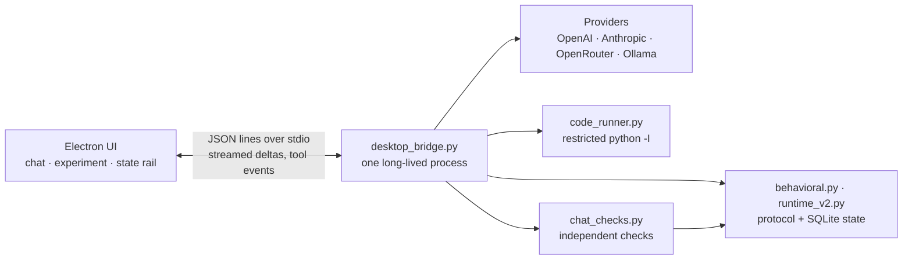

<div align="center">

# Appendix B

**A cognitive research lab where models propose and Python decides.**

*decompose → skeptical attack → independent verification → conclusion*

[](https://github.com/AaronGrace978/appendix-b-substrate/releases/latest)
[](https://github.com/AaronGrace978/appendix-b-substrate/releases/latest)
[](#use-the-substrate-in-python)
[](LICENSE)

With credit to [DinoClaw](https://github.com/AaronGrace978/DinoClaw).

</div>



<sub>Chat view, from a real session with Kimi k3.1 Pro on Ollama Cloud (the model's long reproduction-code listing is trimmed). The model guessed **10,971**, ran one exhaustive search, and concluded. The code card shows a script that reproduces the run's output line for line, executed by the app's own runner. Under the reply, Python independently confirms the claim, and the side rail shows the model's substrate state.</sub>

---

## Why it exists

Language models are good at proposing answers and bad at knowing when they're wrong. Ask one for the smallest n > 10,000 whose Collatz sequence takes at least 260 steps, and a strong reasoning model will often spend its whole output budget doing arithmetic in its head, then stop without answering.

Appendix B puts the model inside a workflow it can't skip:

| Phase | What happens | Enforced by |
|---|---|---|
| **01 Decompose** | Split the task into subproblems before answering | `runtime_v2.Runtime` |
| **02 Attack** | At least two skeptical attacks on the candidate | `runtime_v2.Runtime` |
| **03 Verify** | Evidence comes from a trusted verifier or real code, never from the model's own say-so | your verifier · `code_runner.py` · `chat_checks.py` |
| **04 Conclude** | Supported, refuted or inconclusive; unverified conclusions are blocked | `runtime_v2.Verdict` |

Across turns and runs it carries continuous **substrate state**: curiosity, skepticism, confidence, resolve, strain, surprise and stagnation. A refuted guess raises surprise; repeated candidates raise stagnation; the controller rotates strategy in response. These are explicit workflow variables, not a claim about feelings or private reasoning.

The workflow follows the publicly described pattern of recent human–AI mathematics, where the model proposes and a formal checker decides. It models observable behaviour only; it does not extract or reproduce any model's internals.

## Install the desktop lab

1. Download **`Appendix-B-Setup-vX.Y.Z-win-x64.exe`** from [the latest release](https://github.com/AaronGrace978/appendix-b-substrate/releases/latest).
2. Run it. Python and Electron are bundled; there's nothing else to install. The build is unsigned, so if SmartScreen warns, choose *More info → Run anyway*.
3. Pick a provider (**OpenAI, Anthropic, OpenRouter, Ollama Cloud, Ollama Local**), paste a key, choose a model from the dropdown, and chat.

| In the chat box | Does |
|---|---|
| **Protocol** | Replies follow Decompose → Attack → Verify → Conclude, each phase drawn as its own card |
| **Code** | The model can run Python to compute and check its work, through each provider's native tool calling |
| ✓ / ✗ under a reply | Arithmetic, prime, letter-count and Collatz claims recomputed independently in Python |
| Reasoning panel | Live, collapsible reasoning stream from thinking models (DeepSeek, Kimi, gpt-oss…) |

Keys stay in memory only and are never written to disk.

## Models that run code

With **Code** on, the model gets a `run_python` tool. The app runs each call in a fresh, restricted Python process, sends the output back, and the model carries on, for up to 4 rounds per reply.

<p align="center"></p>

This is the script in that card, also in [`examples/collatz_verify.py`](examples/collatz_verify.py):

```python
def trajectory(n):
    path = [n]
    while n != 1:
        n = n // 2 if n % 2 == 0 else 3 * n + 1
        path.append(n)
    return path

best = 0
for n in range(10001, 10**6):
    path = trajectory(n)
    steps = len(path) - 1
    if steps > best:
        best = steps
        print("new maximum in searched range:", n, steps, "peak", max(path))
    if steps >= 260:
        break
print("FIRST_QUALIFYING", n, "STEPS", steps, "PEAK", max(path))

# Nothing between 10,001 and the candidate may qualify.
print("MAX_BELOW_CANDIDATE_(steps,n):",
      max((len(trajectory(m)) - 1, m) for m in range(10001, n)))
```

```text
new maximum in searched range: 10971 267 peak 975400
FIRST_QUALIFYING 10971 STEPS 267 PEAK 975400
MAX_BELOW_CANDIDATE_(steps,n): (254, 10617)
```

Each run is restricted: 15-second limit, no network, no process spawning, and file reads, writes and listings only inside a throwaway temp folder, so code can't read your files and send them to a cloud model. It is a guard-rail against accidents, not a security sandbox. Use models you trust.

```python
from code_runner import run_code

r = run_code("print(sum(range(10**6)))")
print(r["ok"], r["stdout"].strip())          # True 499999500000

r = run_code("open('/etc/hosts').read()")    # outside the temp folder
print(r["stderr"].strip().splitlines()[-1])  # PermissionError: blocked by the Appendix B code runner
```

## Use the substrate in Python

Zero dependencies, Python 3.10+. A proposer stands in for the model and a verifier computes the truth. Here the first guess is wrong, gets refuted, and the corrected guess is verified ([`examples/substrate_quickstart.py`](examples/substrate_quickstart.py)):

```python
from behavioral import SearchRuntime
from runtime_v2 import Evidence, Verdict, claim_id


def steps(n):
    s = 0
    while n != 1:
        n = n // 2 if n % 2 == 0 else 3 * n + 1
        s += 1
    return s


def proposer(ctx):                      # stands in for a model call
    if ctx["phase"] == "decompose":
        return {"phase": "decompose", "subproblems": ["define a step", "search n > 10,000"]}
    if ctx["phase"] == "hypothesize":   # first guess is wrong on purpose
        return {"phase": "hypothesize", "claim": "10971" if ctx["history"] else "10011"}
    return {"phase": "attack", "attacks": ["off-by-one in the count", "a smaller n might qualify"]}


def verifier(task, claim, strategy, attacks):   # trusted: computed, never asked
    n = int(claim)
    ok = steps(n) >= 260 and all(steps(m) < 260 for m in range(10001, n))
    verdict = Verdict.SUPPORTED if ok else Verdict.REFUTED
    return (Evidence(claim_id(task, claim), "exhaustive", "python", verdict, f"{n} takes {steps(n)} steps"),)


rt = SearchRuntime()                    # SearchRuntime("state.db") persists state across runs
result = rt.search("smallest n > 10,000 with >= 260 Collatz steps", proposer, verifier,
                   required_checks=frozenset({"exhaustive"}), budget=4)

for c in result.candidates:
    print(c.claim, c.verdict.value, "-", c.evidence[0].detail)
print("verdict:", result.verdict.value, result.supported_claims)
print("surprise after the refuted guess:", round(rt.dynamics.surprise, 2))
```

```text
10011 refuted - 10011 takes 210 steps
10971 supported - 10971 takes 267 steps
verdict: supported ('10971',)
surprise after the refuted guess: 0.23
```

### Check claims in any model reply

```python
from chat_checks import extract_checks

reply = "In the Collatz sequence 10,971 takes 267 steps. Also 91 is prime and 7 * 8 = 56."
for c in extract_checks(reply):
    print("✓" if c["verdict"] == "supported" else "✗", c["claim"], "—", c["detail"])
```

```text
✓ 7 * 8 = 56 — Python evaluates: 56 = 56
✗ 91 is prime — 91 = 7 × 13
✓ 10971 takes 267 steps — Python counts 267 steps from 10971 to 1
```

Claims the checker doesn't recognise are simply not checked; no check is not support. Code blocks are evidence, not claims, and are skipped.

## Architecture



| File | Role |
|---|---|
| `runtime_v2.py` | Protocol runtime: decomposition, hypotheses, attacks, claim-bound evidence, verdicts, SQLite event history |
| `behavioral.py` | Coupled substrate dynamics, strategy rotation, bounded candidate search, persistent state |
| `code_runner.py` | Restricted runner for model-written code |
| `chat_checks.py` | Independent checks for claims in free text (bounded AST arithmetic, primes, letters, Collatz) |
| `desktop_bridge.py` | Provider gateway: streaming, native tool calls, retries on 5xx/429, reasoning streams, chat loop |
| `desktop/` | Electron app (context-isolated, sandboxed renderer, strict CSP) |
| `substrate.py` | Original v0.1 substrate, unchanged for baseline comparisons |

## Run the tests

```bash
python -m unittest discover -v      # protocol, dynamics, bridge, runner guards, provider tool round trips, README examples
python substrate.py                 # original primality-conjecture demonstration
python benchmark_behavioral.py      # synthetic controller-wiring benchmark (not evidence about real LLMs)
```

Every push to `main` builds the Windows installer, installs it silently on a clean runner, launch-checks it, and publishes release `v<version>` from `desktop/package.json`.

## Scope and honest limits

- The substrate governs an agent's **external** workflow. It can't make a model's private reasoning follow the protocol, and it can't prove arbitrary claims without an appropriate verifier.
- Open research mode stays **inconclusive** unless a deterministic check applies, because model agreement is not proof.
- State dynamics and attack budgets are heuristics, not calibrated measurements. Distinct attack strings don't guarantee independent reasoning.
- The code runner is a guard-rail, not a sandbox. SQLite records are not tamper-proof.

<details>
<summary><b>Research notes: v0.2 runtime and v0.3 behavioral distillation</b></summary>

### v0.2 runtime

`runtime_v2.py` implements decomposition, explicit hypotheses, state-dependent skeptical attacks, claim-bound evidence, and deterministic conclusions with supported, refuted or inconclusive verdicts. Use `Runtime("state.db")` for durable SQLite state and run event history. The caller supplies an agent callback, a trusted verifier callback and the required check identifiers. The verifier must establish actual evidence and reject claims outside its domain; hashing a claim does not establish truth. Agent-authored final prose cannot bypass verdicts. Conflicting evidence and callback errors produce inconclusive results. Attempt limits do not impose wall-clock timeouts on callbacks. The runtime is synchronous and single-worker; interrupted runs can be inspected but are not automatically resumed. Use a separate database per worker.

### v0.3 behavioral distillation

The idea is to observe AI mathematical problem-solving behaviour and translate observable actions into explicit Python control mechanisms. This is behavioral modeling, not extraction of private model reasoning, weights or consciousness, and not a reproduction of any particular model. `behavioral.py` adds coupled continuous dynamics, surprise after refutation, stagnation after repeated candidates, strategy rotation, a bounded candidate budget and durable state and decision histories. Refuting a candidate does not refute the overall search problem; unresolved searches abstain.

```bash
python trace_replay.py observations.jsonl
```

Observation datasets are JSON Lines, one source-tagged observation per line, recording externally observable outcomes rather than inferred private thoughts (synthetic example):

```json
{"source":"synthetic-fixture","locator":"turn 1","event":"refuted","note":"Arithmetic rejected a candidate divisor."}
{"source":"synthetic-fixture","locator":"turn 2","event":"duplicate","note":"The same candidate was proposed again."}
```

Supported events: supported, refuted, inconclusive and duplicate. Replay yields deterministic before/after state trajectories. Parameters are hypotheses, not fitted measurements.

**Next:** collect documented traces, define an annotation rubric, and compare adaptive, fixed and rotation-only controllers on held-out tasks with real model callbacks, matched token and tool budgets, and independent scoring.

</details>

## Credits

Built by Aaron Grace · [BostonAI.io](https://github.com/AaronGrace978/BostonAi.io). With credit to [DinoClaw](https://github.com/AaronGrace978/DinoClaw).

<p align="center"><br><sub>Promotional concept artwork; illustrative, not measured results.</sub></p>
